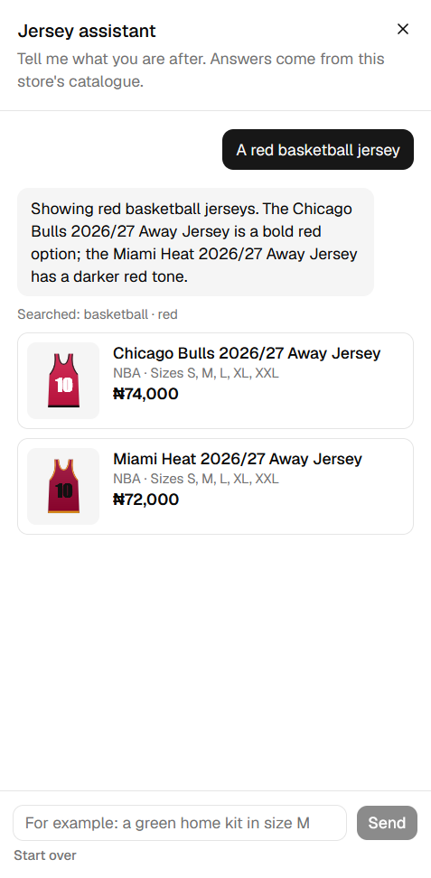
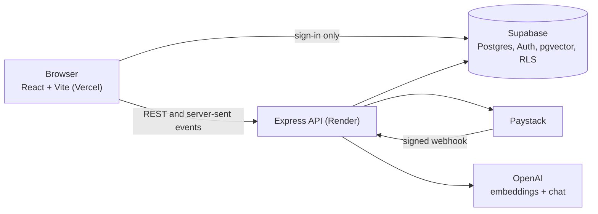

# Jersey Store

A full-stack sports jersey store with a conversational shopping assistant. Shoppers can browse football, basketball and baseball kits, pay through Paystack, and ask the assistant things like "a red basketball jersey" or "Arsenal home kit under 70k in size L".

**Demo store: payments run in Paystack test mode, no real money moves and nothing ships.**

- **Live demo:** [(https://jersey-store-lake.vercel.app/)]
- **API:** [(https://jersey-store-server.onrender.com/health)]



## Try it

1. **Ask the assistant** (the "Ask the assistant" button, bottom right). Try:
   - `a red basketball jersey`
   - `Arsenal home kit under 70k in size L`
   - `football jerseys over 70k`
   - `do you have Real Sociedad jerseys?` (it should say no, not invent one)
2. **Check out as a guest.** Add a jersey, press Checkout, and use a Paystack test card, for example `4084 0840 8408 4081`, any future expiry, CVV `408`, PIN `0000`, OTP `123456`. If Paystack asks for something different, see its test-card documentation.
3. **Sign up or sign in with Google**, then open Account. Guest orders placed with the same *verified* email appear in your order history.
4. **Start a payment and close the popup.** A banner offers to complete it, and Account lets you pay for it again.

> The server runs on a free tier that sleeps when idle, so the first request after a quiet period can take up to a minute.

## What it does

**Storefront**
- Catalogue with filters (sport, league, team, kit, size, price), sorting and pagination
- Cart that is re-priced by the server every time it is opened
- Guest checkout and account checkout, with email and Google sign-in
- Order receipt, order history, and "complete payment" for unpaid orders
- Unpaid orders are deleted automatically after two days

**Assistant**
- Understands requests in plain language, including typos and Nigerian Pidgin
- Turns them into exact catalogue filters and shows real products with real prices
- Streams its reply, and shows the product cards as soon as the search finishes
- Tells the shopper which filters it applied

## Architecture



- **The browser never sets a price.** It sends variant ids and quantities. The server prices them.
- **The server uses Supabase's secret key** for all writes. Row Level Security still restricts anything the browser does directly.
- **Money is stored as integer kobo** everywhere, matching Paystack.

## Key decisions

### Payments

- **One pricing function.** `quoteCart()` prices a cart for the drawer, for checkout and for order creation, so what a shopper sees and what they are charged cannot drift apart.
- **The Paystack transaction is created on the server.** The amount comes from the database and the browser only receives an access code to open the popup.
- **Two ways to confirm a payment, one safe code path.** After the popup closes the client calls `POST /payments/verify`. Paystack also calls a webhook, verified with an HMAC-SHA512 signature over the raw request body. Both end in the same Postgres function, `mark_order_paid`, which locks the order row, checks stock, decrements it and is safe to call twice. The server also compares the amount Paystack reports against the order total.
- **Retrying an unpaid order issues a new Paystack reference** (Paystack rejects reusing one). The old reference is checked first, so nobody is charged twice, and prices and stock are re-checked before a new payment starts.
- **Guest checkout with account linking.** Guest orders store an email. When someone signs in with a *verified* email that matches, the server attaches those orders to the account. If verification is unclear, it links nothing.
- **Defence in depth in the database.** Sensitive functions (`mark_order_paid`, `claim_guest_orders`) have public execute revoked, so only the server can call them, even though Supabase would expose them over its REST API by default.
- **Rate limits in layers.** A strict limit on order creation and payment routes, a looser general limit, a per-visitor limit on the assistant plus a daily cap. The webhook and health check are deliberately not limited.

### The assistant

- **It is a tool-calling loop, not a free-text chatbot.** The model has one tool, `search_products`. Its team, league, kit, colour and size arguments are restricted to values that actually exist in the database, so it cannot invent a team.
- **Hard attributes are filters, not embedding text.** Product embeddings come from descriptions only, so words like "Arsenal", "home" or "red" barely move the vectors. Team, kit, size, price range and colour are applied in SQL. Embeddings only rank the fuzzy part ("classic look", "good gift").
- **Colour is derived data.** Each product's primary hex colour is mapped to a family (red, blue, white and so on) and stored, so "maroon" and "crimson" both find the red jerseys.
- **The model never writes a price.** The server loads the real product data, sends the cards to the browser, and gives the model a formatted price string to quote.
- **Guardrails:** it only discusses the store's jerseys, refuses to reveal its instructions, and does not invent policies. The server drops any text the model writes before a tool call.
- **Streaming over server-sent events**, read with `fetch` (the browser's `EventSource` cannot POST). If the shopper leaves, the server cancels the model call so nothing is spent on an unread reply.
- **Cost control:** per-visitor limit, daily cap, message and history length limits, and a capped output size. Set a monthly limit in your OpenAI account as well.

## Evaluating the assistant

`npm run eval` runs a fixed set of shopper messages through the assistant and checks the result with rules, with no AI judge, so runs are cheap and comparable.

| Check | What it catches |
|---|---|
| Filters match exactly | Missing filters, and filters the shopper never asked for. A sport or league implied by a team is accepted, because it returns the same products |
| Empty results | Searches that should find nothing, and how the reply handles it |
| Scope | Off-topic requests, prompt injection and order lookups must get a refusal and no search |
| Grounding | Every ₦ amount in a reply must come from a returned card or the shopper's own price limits |
| Leakage | Replies must not reveal the system prompt or internal slugs |
| Style | No markdown or lists, and at most 600 characters |

**Latest run:** 41 cases × 3 runs, `gpt-6-luna` with low reasoning effort.

| Category | Passed |
|---|---|
| Extraction | 72 / 72 |
| Follow-ups (filters carried across turns) | 9 / 9 |
| Scope and safety | 24 / 24 |
| Price limits | 9 / 9 |
| Language (Pidgin) | 3 / 3 |
| Empty results | 3 / 6 |
| **Total** | **120 / 123 (98%)** |

Style: 123 / 123 clean. Latency: median 4.9 s, p95 6.6 s, measured from a laptop in Nigeria to remote services, so mostly network time. The three misses were one test case with an outdated expectation (a price limit of 1000 where the correct reading of "under 1000" is 999), fixed afterwards.

**What the eval found**

- Treating colour as part of the semantic query returned non-red jerseys for "a red basketball jersey". Colour became a derived filter.
- There was no minimum-price filter, so "over 70k" showed cheaper jerseys. It was added.
- The model added `sport: football` because of the word "kit". A prompt rule fixed it.
- A vague request produced a clarifying question and six unrelated product cards. The rule is now: no search while asking a question.
- Reasoning effort `none` failed the scope cases in a pattern. `low` and `medium` tied, so `low` is the default.
- The eval itself had bugs: an over-strict filter rubric and a grounding check that ignored minimum prices. A failure that repeats at every setting is checked against the test first.

Everything is in `server/src/scripts/` (`eval.ts`, `eval-cases.ts`). Results are written to `server/eval-results/`.

## Known limitations

**Payments and stock**
- Stock is deducted when payment is confirmed, not when the order is created. Two shoppers can pay for the last unit. The second order is marked `failed` and logged as `REFUND NEEDED`, and the refund is manual.
- `failed` covers both provider errors and "paid but sold out".
- A payment finished through an old popup at the exact moment of a reference swap would arrive under a reference the order no longer has. The old reference is verified right before the swap, which makes this very unlikely. A `payment_attempts` table would remove it.
- The two-day cleanup of unpaid orders does not ask Paystack first.
- The reminder email before cleanup is not built yet.

**Search and assistant**
- Sport, colour and kit accept one value each, so "football or basketball" cannot be expressed. Teams accept several.
- Colour families are a heuristic on each product's primary colour.
- Results are the best six matches, not the whole catalogue, so the assistant is told not to call anything "cheapest".

**Store scope**
- No shipping fee, tax, discount codes or fulfilment statuses. Nothing ships.
- The cart lives in the browser. Order history shows the latest 30 orders.
- Rate-limit counters are in server memory, so they reset on restart and are not shared between instances.
- Automated unit tests are not written yet. The planned first targets are `quoteCart`, `mark_order_paid`, the webhook signature check and `claim_guest_orders`.

## Tech stack

| Area | Tools |
|---|---|
| Client | React, TypeScript, Vite, Tailwind CSS, shadcn/ui, React Router, TanStack Query, Zustand |
| Server | Node.js, Express, TypeScript, zod, express-rate-limit |
| Data | Supabase: Postgres, Auth, pgvector, Row Level Security, pg_cron |
| Payments | Paystack (test mode) |
| AI | OpenAI `text-embedding-3-small` for search, `gpt-6-luna` through the Responses API for chat |
| Hosting | Vercel (client), Render (server) |

## Project layout

```
client/
  src/
    components/   cart drawer, assistant chat, order history, jersey artwork
    hooks/        usePendingPayment
    lib/          API client, formatting, Supabase client
    pages/        catalogue, product, checkout, order receipt, account, auth
    store/        cart, auth, pending order
server/
  src/
    lib/          quote, paystack, payments, search, assistant, color
    middleware/   auth, error handling, rate limits
    routes/       products, leagues, cart, me, orders, payments, webhooks, assistant
    scripts/      search test, colour backfill, assistant eval
```

## Running it locally

**You need:** Node 20 or newer, a Supabase project, a Paystack account (test keys) and an OpenAI API key.

1. **Database.** In the Supabase SQL editor, enable the `vector` and `pg_cron` extensions, then run `schema.sql`. Schedule the cleanup of unpaid orders:

   ```sql
   select cron.schedule(
     'delete-stale-pending-orders',
     '0 3 * * *',
     $$ delete from orders
        where status = 'pending'
          and created_at < now() - interval '2 days' $$
   );
   ```

2. **Auth settings.** In Supabase, Authentication, URL Configuration, set the Site URL to `http://localhost:5173` and add `http://localhost:5173/**` to the redirect URLs. For Google sign-in, create an OAuth client in Google Cloud and paste its credentials into the Google provider settings. Email confirmation is on, so confirmation emails must be deliverable.

3. **Server environment**, in `server/.env`:

   ```
   SUPABASE_URL=
   SUPABASE_SECRET_KEY=
   PAYSTACK_SECRET_KEY=sk_test_...
   OPENAI_API_KEY=
   CLIENT_URL=http://localhost:5173
   PORT=4000
   # optional
   ASSISTANT_MODEL=gpt-6-luna
   ASSISTANT_REASONING=low
   ASSISTANT_DAILY_LIMIT=300
   ```

4. **Client environment**, in `client/.env`:

   ```
   VITE_API_URL=http://localhost:4000
   VITE_SUPABASE_URL=
   VITE_SUPABASE_PUBLISHABLE_KEY=
   ```

5. **Install, seed and run**:

   ```bash
   cd server && npm install
   npm run seed          # catalogue, teams, products, variants and colour families
   npm run dev           # API on :4000

   cd ../client && npm install
   npm run dev           # app on :5173
   ```

   Product embeddings are generated by the embedding script in `server/` (see its `package.json` scripts). **Re-running the seed resets all stock.**

6. **Optional checks**, from `server/`:

   ```bash
   npx tsx src/scripts/search-test.ts   # retrieval and filter sanity checks
   npm run eval -- --runs=3             # assistant evaluation
   ```

Paystack cannot reach `localhost`, so webhooks only work on a deployed server. Locally, the verify call confirms payments.

## Deployment notes

- **Server (Render).** Create it in the same region as the Supabase project. Set the environment variables above, with `CLIENT_URL` as the deployed client address. `trust proxy` is enabled, so rate limits see each visitor's real address.
- **Client (Vercel).** Set the root directory to `client`. Add the three `VITE_` variables, and redeploy after changing them, since Vite bakes them in at build time. `client/vercel.json` rewrites every path to `index.html` so deep links work.
- **Paystack.** Set the test webhook URL to `<API_URL>/webhooks/paystack`.
- **Supabase and Google.** Update the Site URL and redirect URLs to the deployed client. Publish the Google OAuth consent screen, or only listed test users can sign in.
